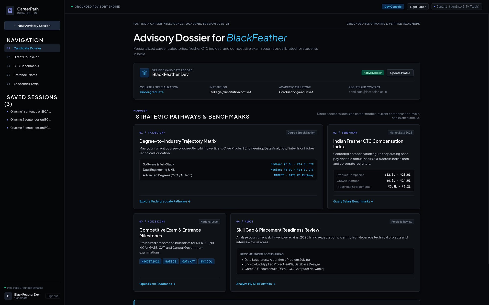
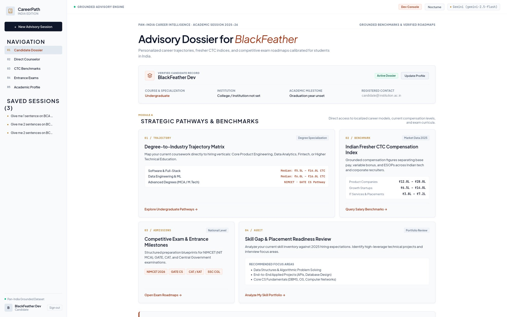
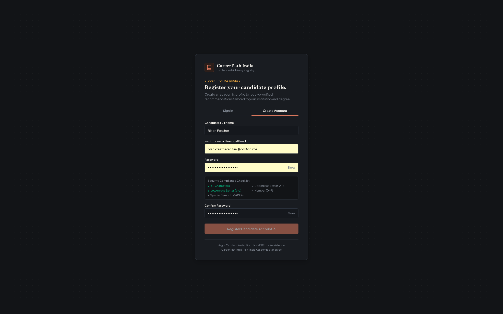
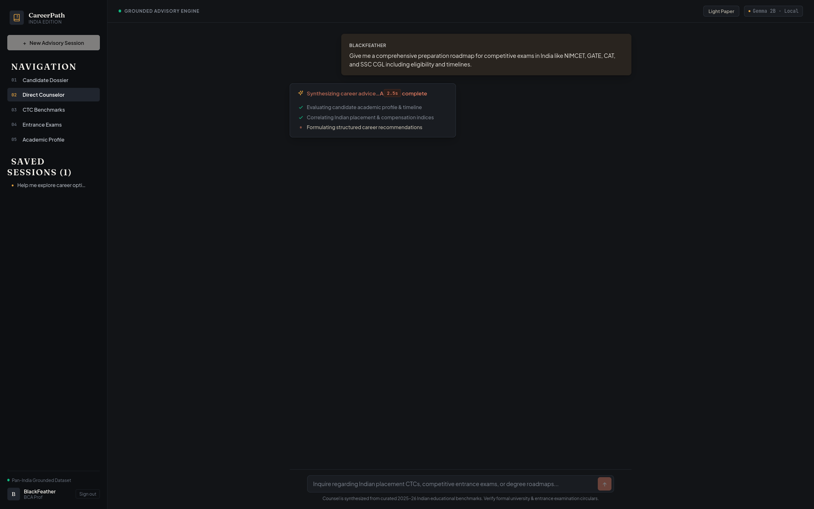
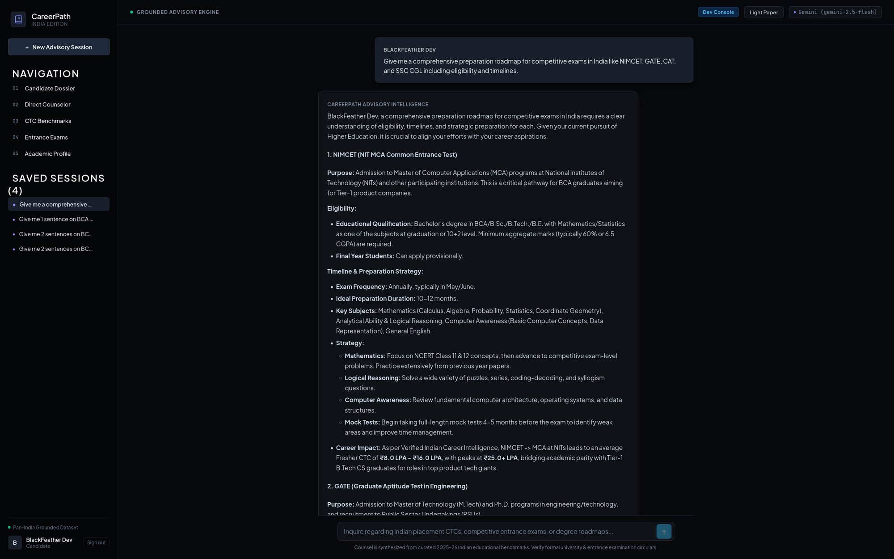
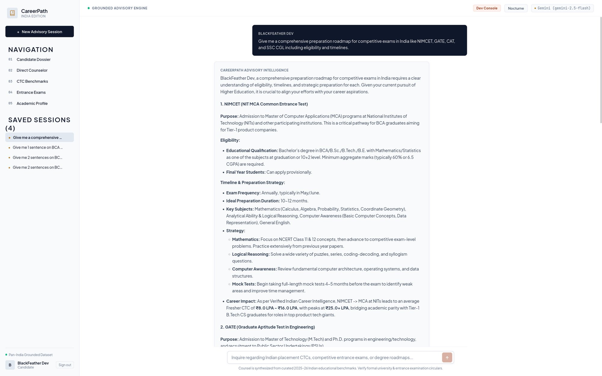
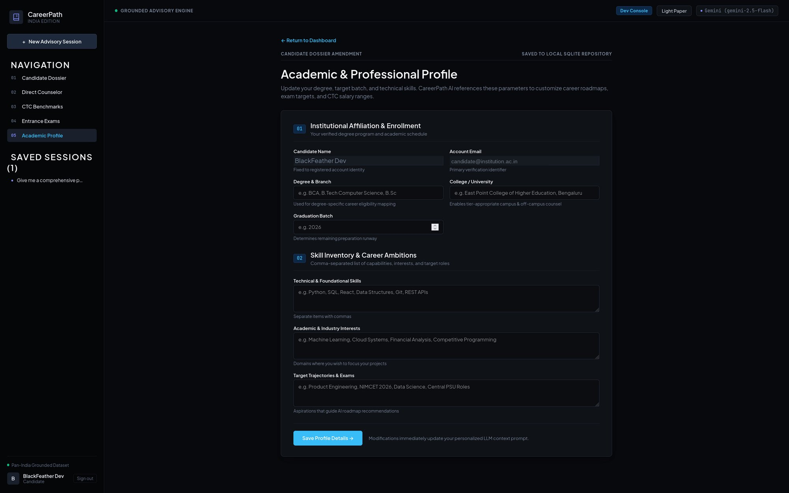
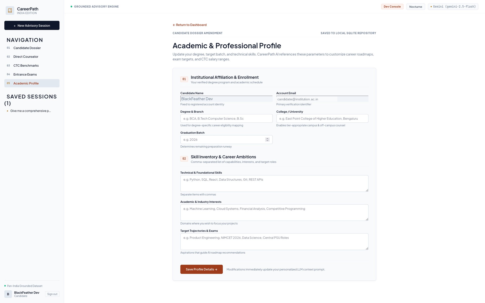

<div align="center">

# CareerPath AI (Future Forge)

**An authoritative, privacy-first career advisory platform engineered with verified Indian compensation benchmarks, academic profile personalization, and real-time streaming inference.**

*FastAPI · Python 3.14 · SQLite (WAL) · React 19 + TypeScript · Local Ollama LLM · Editorial Anti-Slop Design*

<br />

<!-- Hero Screenshot -->


<br />

[Features](#features) · [Interface Gallery](#interface-gallery) · [Why CareerPath AI](#why-careerpath-ai) · [Architecture](#architecture) · [Quick Start](#quick-start) · [macOS & Linux](#macos--linux-setup) · [Windows Guide](#windows-setup-guide) · [Troubleshooting](#troubleshooting) · [Project Structure](#project-structure)

</div>

---

## Features

* **Human-Crafted Editorial Design System**: Zero "AI slop" templates. Replaces generic purple-blue gradients, bouncy cards, and decorative frosted blur with an intentional collegiate design system inspired by academic presses (*Stripe Press*, *The Atlantic*).
* **Distinct Typographic Hierarchy**: Pairs variable optical-size serif [**`Fraunces`**](https://fonts.google.com/specimen/Fraunces) for display headlines with [**`Plus Jakarta Sans`**](https://fonts.google.com/specimen/Plus+Jakarta+Sans) for body text and [**`JetBrains Mono`**](https://fonts.google.com/specimen/JetBrains+Mono) with tabular figures for exact CTC compensation brackets.
* **Asymmetric Editorial Bento Grid**: Strategic 2-tier bento architecture featuring a dominant Degree-to-Industry Trajectory Matrix, 2025–26 Indian Fresher CTC Index, Competitive Exam Roadmaps, and a Portfolio Skill Gap Audit.
* **Collegiate Candidate Docket**: Formats student credentials into an official institutional verification docket with verified degree badges, institution enrollment, and skill tags.
* **Dual Curated Themes (Light Paper & Nocturne Slate)**:
  - **Light Paper**: Warm unbleached linen and bone paper (`#fbf8f3`, `#f4f0e6`) with rich terracotta earth (`#9e3b1b`) and warm amber ochre (`#b87d28`).
  - **Nocturne Slate**: Deep warm graphite and mineral slate (`#121417`, `#191c21`) with warm terracotta flare (`#e07a5f`) and golden saffron (`#e09f3e`).
* **Argon2id Cryptographic Security**: State-of-the-art password protection using Argon2id (RFC 9106 winner of the Password Hashing Competition) and JWT bearer authentication.
* **Disposable Email & Password Policy Defense**: Hardens student registries by enforcing strict password complexity rules and proactively blocking disposable/temporary mailbox domains.
* **Live AI Reasoning Telemetry (`ThoughtLine`)**: Real-time thinking indicator in counselor bubbles displaying live phase transitions, time elapsed telemetry, and non-blocking status steps.
* **Persistent SQLite Conversation Threads**: Multi-session career counseling with automated thread naming, message history persistence, and cascade deletion.
* **Grounded Indian Career Intelligence**: Curated benchmarks covering ICAI placement cycles, central government pay matrices, NIMCET NIT MCA cutoffs, and Indian tier 1/2/3 campus placement realities.
* **100% Local, Private & Free Inference**: Runs entirely on your personal machine via Ollama (Gemma 2B, Qwen 2.5, or Llama 3). Zero API subscriptions, zero telemetry, and total privacy.
* **Fluid Token-by-Token Streaming**: Direct chunked transfer stream (`Transfer-Encoding: chunked`) delivering real-time responses with structured markdown tables.
* **Automated Single-Command Orchestration**: Native launchers (`start.sh` for macOS/Linux, `start.bat` for Windows) that boot Ollama, the FastAPI backend, and the Vite development server simultaneously.

---

## Interface Gallery

<div align="center">

### Candidate Dossier & Strategic Pathways (Nocturne Dark)
*Asymmetric 2-tier bento architecture displaying student credentials, fresher CTC index, and trajectory matrices.*
<br />


<br /><br />

### Candidate Dossier & Strategic Pathways (Editorial Light Paper)
*Warm unbleached linen paper aesthetic with Fraunces serif typography and tactile card surfaces.*
<br />


<br /><br />

### Institutional Candidate Registry & Authentication
*Secure portal access with Argon2id cryptographic protection and real-time password compliance verification.*
<br />


<br /><br />

### Live AI Reasoning Telemetry (`ThoughtLine`)
*Multi-stage inference telemetry displaying active synthesis phases and elapsed timing.*
<br />


<br /><br />

### Nocturne Interactive Advisory Session
*Real-time streamed consultation detailing NIMCET, GATE, CAT, and SSC CGL preparation roadmaps.*
<br />


<br /><br />

### Editorial Light Interactive Advisory Session
*High-contrast structured compensation tables and milestone breakdowns formatted for daylight readability.*
<br />


<br /><br />

### Candidate Dossier Amendment & Profile (Nocturne Dark)
*Academic credentials, university affiliation, and skill inventory customization stored locally.*
<br />


<br /><br />

### Candidate Dossier Amendment & Profile (Editorial Light Paper)
*Daylight editorial theme for managing target trajectories, entrance exam ambitions, and technical portfolios.*
<br />


</div>

---

## Why CareerPath AI?

| Dimension | Generic AI & Web Portals | CareerPath AI |
|:---|:---|:---|
| **Design Language** | AI-slop purple/blue gradients & generic cards | Human-crafted editorial typography & asymmetric bento grid |
| **Knowledge Base** | Western-centric examples or superficial blogs | Grounded on verified Indian academic & CTC hiring data |
| **Personalization** | Forgets user context on every refresh | Persists degree, institution, and skill stack in SQLite |
| **Security & Privacy** | Plaintext or outdated MD5/SHA passwords | Industrial Argon2id hashing + disposable email defense |
| **Data Storage** | Remote corporate cloud servers | 100% local SQLite database (`future_forge.db`) with WAL mode |
| **Salary Data** | Inflated global estimates in USD | Realistic Indian INR (fresher base, variable, and CTC splits) |
| **Reasoning Feedback** | Static spinners or blank latency | Live multi-stage reasoning telemetry with `ThoughtLine` |
| **Execution** | Complex multi-terminal manual configuration | Single-command automated orchestration (`./start.sh` / `start.bat`) |

---

## Architecture

The platform operates as a modular, decoupled local architecture:

```text
┌────────────────────────────────────────────────────────┐
│             React 19 + TypeScript Frontend             │
│   (Vite 8 · Editorial Bento · ThoughtLine · Profiles)  │
└───────────────────────────┬────────────────────────────┘
                            │ REST / Chunked Event Stream / JWT Bearer
                            ▼
┌────────────────────────────────────────────────────────┐
│              FastAPI Async Backend (Python 3.14)       │
│   (Auth Router · Conversations Router · Context RAG)   │
└───────┬───────────────────┬────────────────────┬───────┘
        │                   │                    │
        ▼                   ▼                    ▼
┌───────────────┐   ┌────────────────┐   ┌───────────────┐
│ SQLite (WAL)  │   │ Curated RAG    │   │ Local Ollama  │
│ Users, Chats, │   │ Knowledge Base │   │ (Gemma / Qwen)│
│  Profiles     │   │ (NIMCET, CTC)  │   │               │
└───────────────┘   └────────────────┘   └───────────────┘
```

* **Frontend**: React 19.3, TypeScript 5.9, and Vite 8.3. Pure zero-runtime CSS variables, asymmetric bento layout, collegiate student docket, and dependency-free `ThoughtLine` reasoning component.
* **Backend**: FastAPI 0.162+ with Uvicorn on Python 3.14. Argon2id password verification via `pwdlib`, PyJWT stateless session tokens, and streaming endpoint handlers.
* **Database**: Local SQLite 3 operating with Write-Ahead Logging (`PRAGMA journal_mode=WAL`) and cascading foreign key integrity.
* **Inference**: Local Ollama instance serving Gemma, Qwen, or Llama models with zero cloud dependency.

---

## Dynamic AI Model Routing & Fallback Mechanism (Terminal CLI)

CareerPath AI features a dynamic routing engine that inspects available local hardware and cloud providers before falling back. In the root directory, the native `careerai` CLI automatically discovers Google Gemini 2.5 Flash, active local GPU Ollama instances, and OpenRouter cloud fallback:

```text
careerai ──► Google Gemini 2.5 Flash (Instant, Zero Thinking Budget, 24/7 Cloud)
      │
      ▼ (if Gemini key omitted)
careerai ──► Ollama (Local GPU: dynamically detects active models: lfm2.5, qwen2.5, gemma)
      │
      ▼ (if Ollama is offline or machine lacks GPU)
careerai ──► OpenRouter Cloud API (sk-or-v1-***)
```

### Terminal CLI Commands

```bash
# 1. Inspect live inference route & available models
./careerai status

# 2. Configure Google Gemini API key directly from terminal
./careerai set-gemini "your-gemini-api-key"

# 3. Configure OpenRouter fallback key
./careerai set-key "sk-or-v1-your-key-here"

# 4. Direct Ollama host to a remote or local IP (defaults to 127.0.0.1:11434)
./careerai set-host "http://127.0.0.1:11434"

# 5. Instant terminal advisory query (streams response token-by-token)
./careerai ask "Help me explore career options for a BCA student in India"

# 6. Boot the fullstack platform with resolved inference engine
./careerai start
```

---

## Quick Start

### macOS & Linux Setup

1. Open your terminal in the repository root:
   ```bash
   chmod +x start.sh
   ./start.sh
   ```
2. The launcher automatically verifies Ollama, downloads a model if needed, configures the Python virtual environment, installs frontend dependencies, and boots both servers.
3. Access the application in your browser at: **http://localhost:5173**

---

### Windows Setup Guide

1. Open Command Prompt in the repository folder or simply **double-click `start.bat`**:
   ```cmd
   start.bat
   ```
2. The batch script verifies Python and Node.js, ensures dependencies are installed, launches the FastAPI backend on port 8000, and opens `http://localhost:5173` automatically.

---

## Troubleshooting

### Windows: `Failed to fetch` on Login / Register
* Make sure the backend terminal window is open and reports:
  ```
  INFO: Application startup complete.
  INFO: Uvicorn running on http://127.0.0.1:8000
  ```
* If Python packages were previously interrupted, run:
  ```cmd
  cd backend
  .venv\Scripts\pip install -r requirements.txt
  .venv\Scripts\python -m uvicorn main:app --host 127.0.0.1 --port 8000
  ```

### Windows: Port 5173 Already in Use
* If an orphaned Node process was left running, `start.bat` automatically terminates any conflicting process on port 5173 to ensure clean binding.

---

## Project Structure

```text
career-guidance-chatbot/
├── assets/                  # High-resolution screenshots for documentation
│   ├── dashboard.png        # Candidate Dossier (Nocturne)
│   ├── dashboard_light.png  # Candidate Dossier (Editorial Light)
│   ├── login.png            # Candidate Registry & Authentication
│   ├── ai_thinking.png      # Real-Time Reasoning Telemetry
│   ├── chat_dark.png        # Nocturne Advisory Consultation
│   ├── chat_light.png       # Editorial Light Advisory Consultation
│   ├── profile_dark.png     # Candidate Dossier Amendment (Nocturne)
│   └── profile_light.png    # Candidate Dossier Amendment (Editorial Light)
├── backend/
│   ├── auth.py              # Argon2id password hashing, validation & JWT
│   ├── conversations.py     # Conversation threads CRUD endpoints
│   ├── database.py          # SQLite schema, WAL mode, migrations
│   ├── main.py              # FastAPI app, streaming chat & model binding
│   ├── requirements.txt     # Locked production dependencies
│   └── test_app.py          # 10/10 automated verification test suite
├── frontend/
│   ├── src/
│   │   ├── components/
│   │   │   ├── ThoughtLine.jsx   # Live reasoning indicator (dependency-free)
│   │   │   └── ThoughtLine.css   # Theme-aware styling & responsive layout
│   │   ├── App.tsx          # Main application shell & consultation dossier
│   │   ├── App.css          # Editorial design tokens, themes & bento grid
│   │   ├── AuthScreen.tsx   # Collegiate student registration modal
│   │   ├── StudentDashboard.tsx # Asymmetric bento dashboard & docket
│   │   └── StudentProfile.tsx   # Academic profile editor
│   ├── index.html           # Google Fonts preconnect (Fraunces, Plus Jakarta, JetBrains Mono)
│   └── package.json         # React 19, TypeScript 5, Vite 8
├── careerai                 # Terminal dynamic AI model routing & fallback CLI
├── start.sh                 # macOS & Linux single-command launcher
├── start.bat                # Windows single-command automated launcher
└── README.md                # System documentation & interface showcase
```
