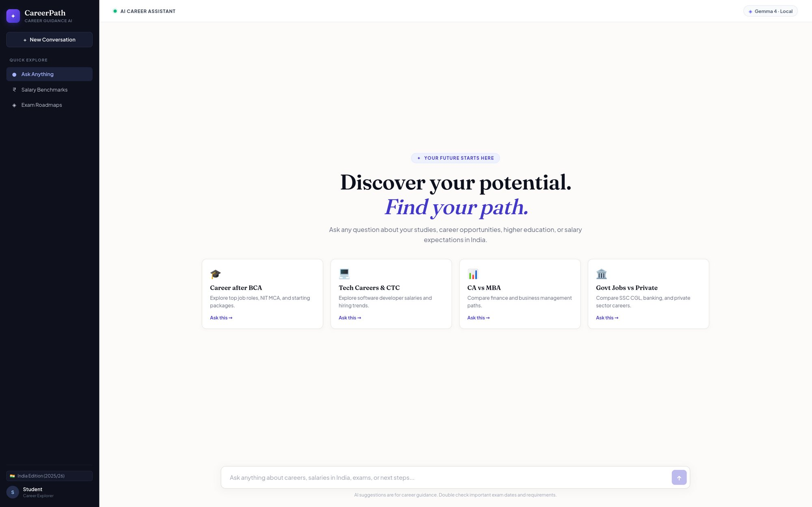
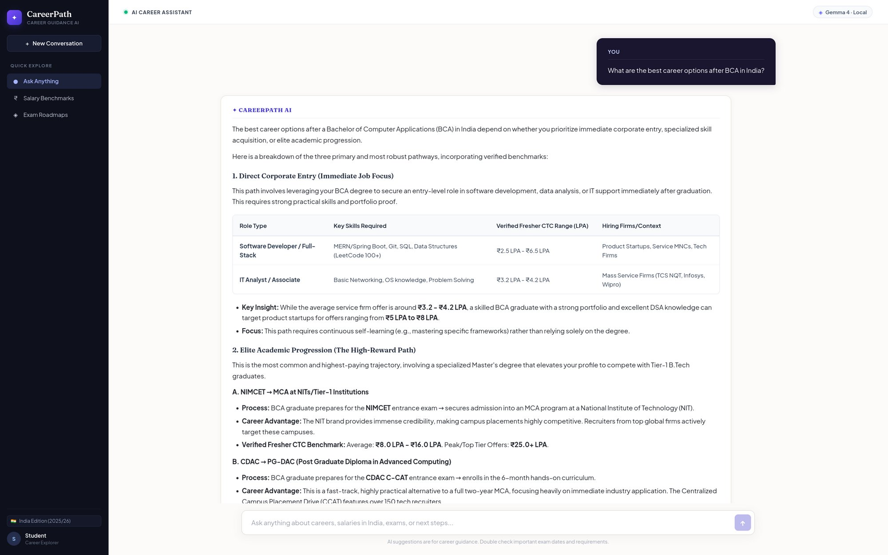

<div align="center">

# CareerPath AI (Future Forge)

**An intelligent, privacy-first career guidance platform with verified Indian benchmarks, student profile personalization, and real-time token streaming.**

*FastAPI · SQLite · React 19 + TypeScript · Local Ollama LLM · Curated RAG · Zero Cloud Dependencies*

<br />

<!-- Hero Screenshot -->


<br />

[Features](#features) · [Comparison](#why-careerpath-ai) · [Architecture](#architecture) · [Quick Start](#quick-start) · [macOS Guide](#macos-setup-guide) · [Windows Guide](#windows-setup-guide) · [Troubleshooting](#troubleshooting) · [Project Structure](#project-structure)

</div>

---

## Features

* **Student Authentication & Secure Sessions**: Built-in registration and login using Argon2 password hashing and JWT bearer authentication.
* **Student Career Dashboard**: Personalized overview displaying your degree, college, graduation timeline, and rapid-access career exploration pathways.
* **Student Profile System**: Save your course, college name, graduation year, technical skills, interests, and target career domains.
* **Profile-Connected AI Personalization**: The AI counselor reads your student background to deliver hyper-targeted advice tailored to your degree, timeline, and current skill set instead of generic responses.
* **Persistent SQLite Conversation History**: Automatically saves chat threads, user queries, and streamed AI responses with full cascade deletion and title generation.
* **Grounded Indian Career Benchmarks**: Integrates factual data from ICAI campus placements, 7th Pay Commission pay scales, NIMCET NIT MCA statistics, and Indian tech hiring tiers (mass service firms, startups, and GCCs).
* **100% Local and Free Inference**: Runs entirely on your personal machine through Ollama (Gemma, Qwen, or Llama). Zero recurring subscriptions, zero telemetry, and complete privacy.
* **Auto-Discovery Model Binding**: Automatically inspects the local Ollama daemon and binds to the active model without hardcoded configuration.
* **Fluid Token Streaming**: Streams responses directly to the client token-by-token with smooth animation and instant rendering.
* **Sliding Window Context Memory**: Maintains a lean 4-turn conversational buffer to prevent local GPU/CPU VRAM exhaustion while preserving thread continuity.
* **Single Command Startup**: Unified cross-platform launchers (`start.sh` for macOS/Linux, `start.bat` for Windows) that boot Ollama, the FastAPI backend, and the React frontend simultaneously.

---

## Why CareerPath AI?

| Dimension | Generic AI & Web Portals | CareerPath AI |
|:---|:---|:---|
| **Knowledge Base** | Western-centric examples or generic blogs | Grounded on Indian academic and industry benchmarks |
| **Personalization** | Forgets who you are on every new session | Connects student profile (degree, skills, year) to AI |
| **Conversation Storage**| Stored on remote corporate servers | 100% local SQLite database (`future_forge.db`) |
| **Salary Data** | Inflated global estimates in USD | Realistic Indian INR (fresher CTC and in-hand breakdowns) |
| **Privacy & Cost** | Requires paid cloud APIs and internet access | 100% offline local inference with zero operational cost |
| **Memory Management**| Unbounded context causes local LLM slowdowns | 4-turn sliding context window optimized for laptop hardware |
| **Data Presentation** | Monolithic walls of unformatted text | Clean, interactive markdown tables and structured roadmaps |
| **Execution** | Complex multi-terminal manual configuration | Single-command automated orchestration (`./start.sh` / `start.bat`) |

<br />

<div align="center">
  
</div>

<br />

---

## Architecture

The system is organized into a modular decoupled architecture:

```text
┌────────────────────────────────────────────────────────┐
│             React 19 + TypeScript Frontend             │
│   (Vite · Dashboard · Profile Editor · Chat History)   │
└───────────────────────────┬────────────────────────────┘
                            │ REST / Event Streaming / JWT Bearer
                            ▼
┌────────────────────────────────────────────────────────┐
│                   FastAPI Backend                      │
│   (Auth Router · Conversations Router · RAG Pipeline)  │
└───────┬───────────────────┬────────────────────┬───────┘
        │                   │                    │
        ▼                   ▼                    ▼
┌───────────────┐   ┌────────────────┐   ┌───────────────┐
│ SQLite DB     │   │ Curated RAG    │   │ Local Ollama  │
│ (Users, Chats,│   │ Knowledge Base │   │ (Gemma / Qwen)│
│  Profiles)    │   │ (NIMCET, ICAI) │   │               │
└───────────────┘   └────────────────┘   └───────────────┘
```

* **Frontend**: Built with React 19, TypeScript, and Vite. Features a dark widescreen layout, student dashboard, profile editor, previous chat sidebar history, and markdown table rendering.
* **Backend**: Powered by FastAPI and Uvicorn. Implements JWT authentication, profile management, conversation persistence, model resolution, and streaming generation.
* **Database**: Local SQLite database storing student accounts, hashed credentials, profiles, conversation threads, and chat messages.
* **RAG Layer**: Curated repository containing verified Indian compensation bands, exam timelines, and qualification criteria.
* **Inference Engine**: Standard Ollama instance running locally on CPU or Apple Silicon/NVIDIA GPU.

---

## Quick Start

### 1. macOS & Linux (Automated)

Open Terminal in the project root and run:

```bash
chmod +x start.sh
./start.sh
```

The script will automatically check Ollama, pull a model if missing, set up Python dependencies, install frontend packages, and launch both servers.

Access the web interface at: **http://localhost:5173**

---

### 2. Windows (Automated)

Open Command Prompt in the project root or simply **double-click `start.bat`**:

```cmd
start.bat
```

The batch script will verify Ollama, set up Python and Node dependencies automatically, and open `http://localhost:5173` in your default browser.

---

## macOS Setup Guide

If running on Apple Silicon (M1/M2/M3/M4) or Intel Mac:

1. **Install Ollama**:
   Download and install the macOS application from [ollama.com/download](https://ollama.com/download). Launch Ollama from your Applications folder (the Ollama icon appears in the top menu bar).

2. **Download an AI Model**:
   Open Terminal and run:
   ```bash
   ollama pull gemma:2b
   ```
   *(or `ollama pull qwen2.5:3b`)*

3. **Start the Application**:
   Navigate to the project folder and run:
   ```bash
   ./start.sh
   ```

---

## Windows Setup Guide

1. **Prerequisites**:
   * Install Python 3.10+ from [python.org](https://www.python.org/downloads/) *(make sure to check "Add Python to PATH" during installation)*.
   * Install Node.js 18+ from [nodejs.org](https://nodejs.org/).
   * Install Ollama for Windows from [ollama.com/download](https://ollama.com/download).

2. **Download an AI Model**:
   Open Command Prompt and run:
   ```cmd
   ollama pull gemma:2b
   ```

3. **Start the Application**:
   Double-click `start.bat` in the project root folder.

---

## Troubleshooting

| Issue | Likely Cause | Resolution |
|:---|:---|:---|
| **"AI model connection failed"** | Ollama daemon is not active. | Run `ollama serve` or open the Ollama app. |
| **"No model found"** | No LLM downloaded in Ollama. | Run `ollama list`. If empty, download one with `ollama pull gemma:2b`. |
| **Port 8000 or 5173 in use** | A previous instance was not terminated. | Free ports by running `lsof -ti:8000,5173 \| xargs kill -9`. |
| **High inference latency** | Model parameter size exceeds available RAM. | Switch to a smaller quantized model such as `gemma:2b` or `qwen2.5:3b`. |
| **CORS or Auth error** | Frontend port mismatch. | Ensure the client runs on `localhost:5173` or `localhost:3000`. |

---

## Project Structure

```text
career-guidance-chatbot/
├── backend/
│   ├── data/
│   │   ├── india_career_knowledge.json  # Curated Indian career benchmarks
│   │   └── future_forge.db              # SQLite database (auto-created)
│   ├── auth.py                          # User registration, JWT login, and profile API
│   ├── conversations.py                 # Chat history and conversation management
│   ├── database.py                      # Database schema and table initialization
│   ├── main.py                          # FastAPI endpoints, streaming, and model discovery
│   ├── rag.py                           # Semantic search and reasoning filter
│   ├── requirements.txt                 # Backend Python dependencies
│   ├── test_app.py                      # Automated test suite for auth, chats, and RAG
│   └── .env.example                     # Environment configuration template
├── frontend/
│   ├── src/
│   │   ├── App.tsx                      # Main app shell, navigation, and stream reader
│   │   ├── App.css                      # Widescreen dark layout and component styling
│   │   ├── AuthScreen.tsx               # Student registration and login interface
│   │   ├── StudentDashboard.tsx         # Personalized career overview & pathways
│   │   ├── StudentProfile.tsx           # Profile editor (course, year, skills, domains)
│   │   ├── MarkdownMessage.tsx          # Markdown and table renderer
│   │   ├── main.tsx                     # React root mount
│   │   └── index.css                    # Viewport reset styles
│   ├── index.html                       # HTML entry point
│   ├── package.json                     # Frontend dependencies
│   └── vite.config.ts                   # Vite configuration
├── assets/                              # Screenshots and documentation media
├── start.sh                             # macOS and Linux launcher script
├── start.bat                            # Windows double-click launcher script
├── .gitignore                           # Git exclusion rules
└── README.md                            # Project documentation
```

---

## Verification & Testing

Verify full backend pipeline (Auth, Profiles, Conversations, Streaming):
```bash
python3 backend/test_app.py
```

Verify frontend TypeScript build:
```bash
cd frontend && npm run build
```

---

## License

Academic and educational open-source project. Developed for student career counseling and curriculum guidance.
